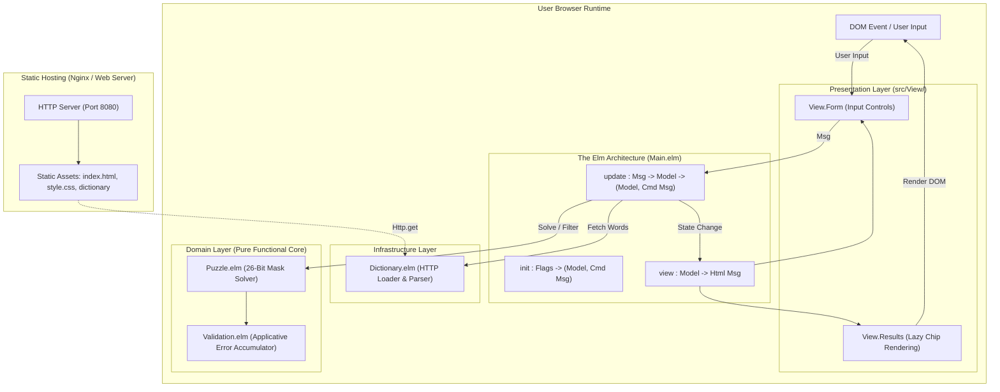
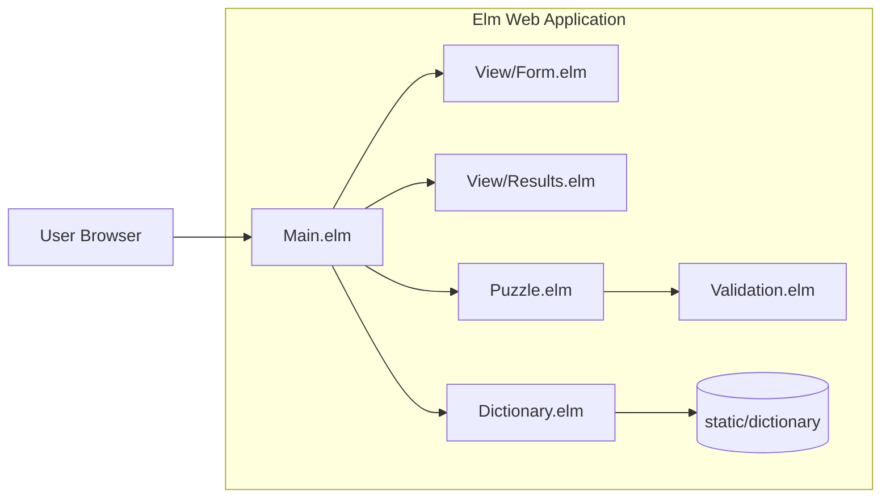
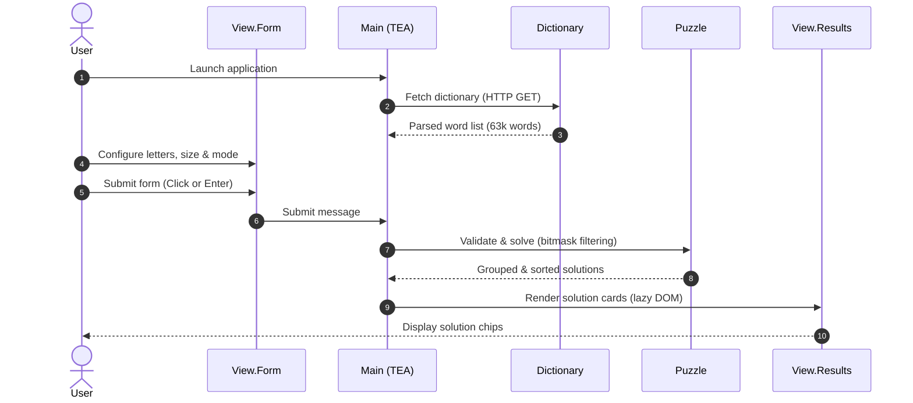

# Elm Word Puzzle Solver

A client-side web application written in [Elm](https://elm-lang.org/) to solve
constraint-based letter word puzzles:

- [Nine Letter Word](http://nineletterword.tompaton.com/adevcrsoi/)
- [Your Word Life](http://www.yourwiselife.com.au/games/9-letter-word/)
- [Scientific American Spellements][spellements]

[spellements]: https://www.scientificamerican.com/game/spellements/

This project directly ports the domain models, bitmask solver engine, and
applicative validation from the reference
[Haskell Word Puzzle Solver](https://github.com/frankhjung/haskell-wordpuzzle).
It runs entirely in the browser without any server backend.

## Project Structure

This project is a browser-only Elm app. It loads the static word list, validates
the player input, solves the puzzle with a bitmask-based engine, and renders the
matching words as chips.

The main modules are:

- `src/Main.elm`: Elm architecture entry point, flags, and application state.
- `src/View/Form.elm`: accessible user input controls and form validation.
- `src/View/Results.elm`: granular lazy card rendering of solved words.
- `src/Dictionary.elm`: 4-state RemoteData loader and length-partitioned 32-bit
  bitmask index (`WordIndex`).
- `src/Puzzle.elm`: opaque domain model, two-tier bitmask solver, and word
  grouping.
- `src/Validation.elm`: applicative validation and error accumulation.

The application preloads `static/dictionary.js` via initialisation flags, with
fallback to asynchronous HTTP retrieval of `static/dictionary`.

## Quick Start Guide

### Prerequisites

- [Node.js](https://nodejs.org/) (v20+ or v24+)
- [Elm 0.19.1](https://guide.elm-lang.org/install/elm.html)
- [GNU Make](https://www.gnu.org/software/make/)

### Installation

Clone the repository and install development tooling:

```bash
git clone https://github.com/frankhjung/elm-wordpuzzle.git
cd elm-wordpuzzle
make deps
```

### Development Server

Compile and launch the local HTTP server:

```bash
make run
```

Open your browser at `http://localhost:8080`.

### Building for Production

To create an optimised, minified production build in `dist/`:

```bash
make build
```

This compiles `src/Main.elm` with `--optimize`, compresses the JavaScript bundle
with Terser, and copies all static assets.

## Testing and Verification

The test suite consists of 51 automated unit and property fuzz tests (including
a port of the Haskell test suite, state machine tests, dictionary index tests,
and invariant property tests), alongside differential parity tests comparing the
Elm solver directly against the compiled Haskell binary:

```bash
# Run unit and property fuzz tests
make test

# Verify code formatting and type-check sources
make check

# Run static analysis and linter
make lint

# Run differential parity tests against Haskell binary
make parity

# Execute the complete CI validation suite
make ci
```

## Available Make Targets

Run `make help` to inspect available targets:

| Target      | Description                                    |
| :---------- | :--------------------------------------------- |
| `default`   | Run format, check, lint, test, and build       |
| `deps`      | Install npm development dependencies           |
| `format`    | Format Elm sources and test files              |
| `check`     | Type-check Elm sources and validate formatting |
| `lint`      | Validate formatting and execute elm-review     |
| `test`      | Execute Elm unit and property fuzz tests       |
| `build`     | Build optimised production bundle in `dist/`   |
| `run`       | Run local HTTP development server              |
| `parity`    | Run parity comparison against Haskell binary   |
| `ci`        | Run full continuous integration pipeline       |
| `clean`     | Remove build artefacts and compiler caches     |
| `distclean` | Remove all build artefacts and node_modules    |
| `help`      | Display available Makefile targets             |

## Project Documentation

- [Design Documentation](docs/design.md)
- [Elm Quick Start Guide](docs/elm-quick-start.md)
- [Hamming Weight / Popcount Notes](docs/hamming-weight.md)
- [Requirements Documentation (Baseline)](docs/REQ-001-word-puzzle-solver.md)
- [Modernisation Requests (REQ-002)](docs/REQ-002-refactor-and-modernise.md)
- [Project Review](docs/project-review.md)

## Domain Glossary

Key domain terms are defined in [GLOSSARY.md](GLOSSARY.md):

- **Mandatory Letter**: The single letter required in every matching word.
- **Other Letters**: Secondary letters completing the allowed pool.
- **Letter Pool**: The full set of 4–9 allowed unique lowercase letters.
- **Word Size**: Minimum length constraint (4 to 9 characters).
- **Nine Letters**: Standard mode where pool letters cannot repeat.
- **Repeats**: Mode permitting letters to repeat without length limits.

## Related Word Puzzle Solver Implementations

This project is part of a multi-language implementation series:

- [Clojure](https://github.com/frankhjung/clojure-wordpuzzle)
- [Flutter](https://github.com/frankhjung/flutter-wordpuzzle)
- [Go](https://github.com/frankhjung/go-wordpuzzle)
- [Haskell](https://github.com/frankhjung/haskell-wordpuzzle) (Reference)
- [Java](https://github.com/frankhjung/java-wordpuzzle)
- [Kotlin](https://github.com/frankhjung/kotlin-wordpuzzle)
- [Lean 4](https://github.com/frankhjung/lean-wordpuzzle)
- [Python](https://github.com/frankhjung/python-wordpuzzle)
- [TypeScript](https://github.com/frankhjung/typescript-wordpuzzle)

## Architecture Overview

### Architectural Diagram



### Component Diagram



### Sequence Diagram



## Licence

BSD-3-Clause. Copyright (c) 2017-2026 Frank Jung. See [LICENSE](LICENSE) for
details.
