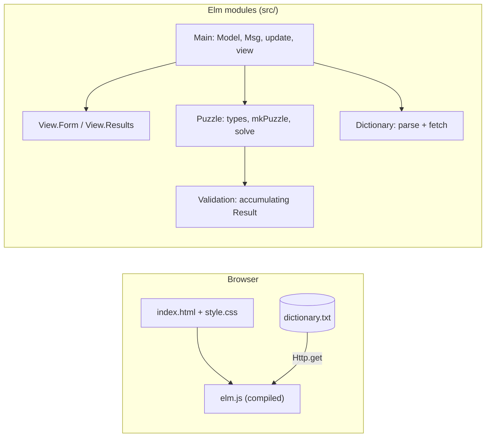

# Elm Word Puzzle Solver: Implementation Plan

## Goal Description

Build a client-side web interface for the word puzzle solver in Elm 0.19.1,
in `/home/frank/dev/elm/wordpuzzle`.

The app ports the **Haskell** solver semantics (the reference for rules and
validation) and adopts the **Flutter** responsive user interface layout (form
on the left, results grouped by word length on the right, mandatory letter
highlighted). There is no server backend. The dictionary is a static text file
fetched once by the browser, and puzzle matching runs client-side in Elm.

### Comparison Across Implementations

| Feature | Haskell CLI | Flutter Web | Elm Application |
| :--- | :--- | :--- | :--- |
| Mandatory | Option `-m` | First of `letters` | Separate field |
| Letter pool | 4–9 unique `a-z` | 7+ letters | 4–9 unique `a-z` |
| Other letters | Pool includes it | 6+ characters | 3–8 characters |
| Min word size | 4–9 | 4+ | 4–9 |
| Repeats off | Single use, max 9 | Single use | Capped at 9 |
| Repeats on | No upper bound | No upper bound | No upper bound |
| Validation | Applicative (all) | First error only | All errors together |
| Ordering | Dictionary order | Length desc, A–Z | Length desc, A–Z |
| Dictionary | wamerican (63k) | Scrabble (245k) | wamerican (63k) |
| Repeats def. | Off (flag) | On | On |

Haskell solver rules (from `WordPuzzle.hs`), which the Elm port matches
strictly:

- Word length `>= size`, and `<= 9` when repeats are disabled.
- Word must contain the mandatory character.
- Repeats on: every character of the word is in the pool (`spellingBee`).
- Repeats off: every character is in the pool and no character occurs twice
  (`nineLetters`, implemented with a 26-bit mask).

## Scope and Non-Goals

### In Scope

- Pure Elm 0.19.1 client-side single-page application.
- Applicative error accumulation reporting all validation failures together.
- Dual visual feedback on validation failure: field-level `aria-invalid`
  borders plus an aggregated error summary.
- Responsive layout: single column on narrow screens (< 768 px), split form
  and results panes on wider screens.
- Word chips grouped by length with bold teal highlighting for the mandatory
  character.
- Offline resilience via static asset caching in the browser.

### Explicit Non-Goals

- Client-side search or filtering within generated solution word chips.
- External dictionary definition lookups (e.g. Wiktionary links).
- Click-to-copy interaction on word chips.
- Shareable URL hashes or query parameter state synchronisation.
- Web Worker background thread execution (standard Elm execution is fast
  enough for 63k words).
- Multi-dictionary selection or runtime upload of custom word lists.

## User Review and System Constraints

> [!IMPORTANT]
> **Network access is required for initial setup.** `npm install` and the
> initial `elm make` execution (to cache standard packages into `~/.elm`)
> require network connectivity.

> [!IMPORTANT]
> **Read-only access to sibling repositories.** The sandbox requires read access
> to `/home/frank/dev/haskell/wordpuzzle/dictionary` to copy the Debian
> `wamerican` dictionary and access to `~/.local/bin/wordpuzzle` for solver
> parity verification.

## Architecture



The domain logic is strictly decoupled from the UI: `Puzzle` and `Validation`
are pure Elm modules with zero HTML or HTTP dependencies.

### Domain Types (`Puzzle.elm`)

```elm
module Puzzle exposing
    ( Puzzle, ValidationError(..)
    , mkPuzzle, size, mandatory, letters, repeats
    , solve, nineLetters, spellingBee
    , errorToString
    )

type Puzzle
    = Puzzle
        { size : Int
        , mandatory : Char
        , letters : String
        , repeats : Bool
        , poolMask : Int
        }

type ValidationError
    = InvalidSize ( Int, Int ) Int
    | InvalidLetters String
    | SizeNotANumber String
    | InvalidMandatory Char
    | MissingMandatory
    | MandatoryNotInLetters Char String

mkPuzzle :
    Bool -> Int -> Char -> String -> Validation ValidationError Puzzle
mkPuzzle r s m ls =
    Validation.succeed (\sz md l -> Puzzle { size = sz, ... })
        |> Validation.andMap (validateSize s)
        |> Validation.andMap (validateMandatory m)
        |> Validation.andMap (validateLetters ls)
        |> Validation.keep (validateMandatoryInLetters m ls)
```

### Form Input and Validation Mapping

The user interface provides two separate text fields:

1. **Mandatory letter** (1 lowercase ASCII character).
2. **Other letters** (3 to 8 lowercase ASCII characters).

On form submission, the UI combines them: `letters = mandatory ++ otherLetters`.
If the user mistakenly repeats the mandatory character inside the other letters
field, the `validateLetters` check detects the duplicate and returns an
`InvalidLetters` error.

Dual feedback is applied on validation failure:

- The summary alert container displays all human-readable error messages.
- Specific form fields associated with errors receive `aria-invalid="true"` and
  an error border.

### State Transitions and Lifecycle

```elm
type alias Model =
    { dictionary : Dictionary.Status
    , form : Form
    , outcome : Outcome
    }

-- Defined in Dictionary.elm:
type Status
    = Loading
    | Loaded Dictionary
    | Failed Http.Error

type alias Form =
    { mandatory : String
    , otherLetters : String
    , size : String
    , repeats : Bool
    }

type Outcome
    = NotSolved
    | Invalid (List ValidationError)
    | Solved Puzzle (List WordGroup)
```

Key state invariants:

- **Dictionary loading:** Form inputs remain fully interactive, but the
  **Solve** button is disabled with a loading spinner until the dictionary has
  been parsed.
- **Dictionary failure:** If the dictionary fails to download, an inline banner
  renders an error message and a **Retry** button.
- **Editing after solve:** When form inputs are modified after a puzzle has been
  solved, existing results remain displayed until the user clicks **Solve** or
  presses Enter.

### Results Presentation and Rendering

Solution words are rendered as a flat, scrollable list of cards grouped by word
length, ordered descending (e.g. 9-letter words first, down to 4-letter words).
Words within each card are sorted alphabetically.

To guarantee zero UI latency when editing form inputs, the results pane is
wrapped with `Html.Lazy.lazy`, ensuring virtual DOM reconciliation of result
chips only executes when the solved puzzle outcome changes.

---

## Proposed Changes

### Project Scaffold

#### [NEW] elm.json

Application manifest for Elm 0.19.1 with direct dependencies:
`elm/browser`, `elm/core`, `elm/html`, and `elm/http`.

#### [NEW] package.json

Development tooling: `elm-test`, `elm-format`, `elm-review`, and `terser`.

#### [NEW] .gitignore

Ignore `elm-stuff/`, `node_modules/`, and `dist/`.

#### [NEW] LICENSE

BSD-3-Clause licence matching the Haskell solver repository.

---

### Domain Layer

#### [NEW] src/Validation.elm

Applicative error accumulator (`Validation e a = Result (List e) a`) with
`succeed`, `fail`, `andMap`, and `keep`.

#### [NEW] src/Puzzle.elm

Domain model, smart constructor, bitmask solver, word grouping, and error
string formatting.

#### [NEW] src/Dictionary.elm

Dictionary parser and HTTP loader using `dictionary.txt`. Filters out words with
non-lowercase ASCII characters during parse time to safeguard the 26-bit mask.

---

### UI Layer

#### [NEW] src/Main.elm

`Browser.element` wiring managing initialisation, update cycles, and layout.

#### [NEW] src/View/Form.elm

Accessible form inputs with labels, helper texts, error highlights, and submit
triggers.

#### [NEW] src/View/Results.elm

Status alerts, error summaries, and word cards with highlighted mandatory
characters.

#### [NEW] static/index.html

Minimal HTML5 entry point mounting the compiled Elm application.

#### [NEW] static/style.css

Responsive CSS grid with teal accent theme, dark mode support, and focus rings.

#### [NEW] static/dictionary.txt

Debian `wamerican` word list (63,031 words, 589,474 bytes) identical to the
Haskell project dictionary.

---

### Tests and Verification

#### [NEW] tests/PuzzleTest.elm

Unit tests porting the Haskell `TestSpec.hs` suite (23 test cases in total).

#### [NEW] tests/PuzzlePropertyTest.elm

Property-based fuzz tests verifying invariant preservation across random words
and letter pools.

#### [NEW] tests/DictionaryTest.elm

Validation of dictionary parsing against CRLF lines, empty lines, and non-ASCII
tokens.

#### [NEW] tests/MainTest.elm

State transition tests for `update` handling form edits, retries, and solves.

#### [NEW] scripts/parity.sh

Differential testing script asserting identical outputs between the Elm solver
worker and `~/.local/bin/wordpuzzle`.

---

### Tooling and Documentation

#### [NEW] Makefile

Defines standard targets: `deps`, `format`, `lint`, `test`, `build`, `run`,
`parity`, and `ci`.

#### [NEW] Dockerfile and docker-compose.yml

Containerised multi-stage build serving static assets via Nginx on port 8080.

#### [NEW] GLOSSARY.md

Domain glossary defining core concepts in Australian English.

#### [NEW] README.md and docs/design.md

Documentation of architecture, usage, and design trade-offs.

---

## Verification Plan

### Automated Verification

```bash
make deps      # Install npm development tools
make format    # Validate and apply code formatting
make lint      # Check formatting and run elm-review
make test      # Execute all unit and fuzz tests
make build     # Compile optimised and minified distribution
make parity    # Verify identical output against the Haskell binary
```

### Manual Verification

1. Solve standard Nine Letter Word puzzle: mandatory `c`, other letters
   `adevrsoi`, size 7, repeats off. Verify output matches `discover`, `divorce`,
   `divorces`, `sidecar`, `varicose`, and `viscera`.
2. Solve Spelling Bee puzzle: mandatory `m`, other letters `itncao`, size 4,
   repeats on. Confirm presence of both `manic` and `maniac`.
3. Submit invalid form (e.g. duplicate letters, out-of-range size) and verify
   dual visual feedback (field borders plus summary alert).
4. Verify responsive reflow between desktop/tablet (>= 768 px) and mobile
   viewports.
