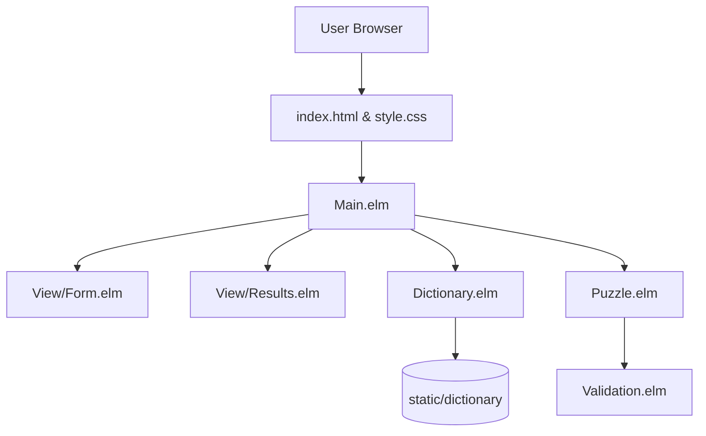

# Architecture and Design

## 1. Project Overview

The Elm Word Puzzle Solver is a client-side single-page web application compiled
with Elm 0.19.1. It provides a modern browser user interface for solving
constraint-based letter puzzles including Nine Letter Word and NYT Spelling Bee
games.

The architecture directly ports the domain semantics, bitmask solver, and
applicative error accumulation from the reference Haskell command-line
implementation
([haskell-wordpuzzle](https://github.com/frankhjung/haskell-wordpuzzle)).

## 2. Core Architecture

The application is structured into four distinct layers:

1. **Domain Layer (`Puzzle.elm`, `Validation.elm`):** Pure functional core
   containing opaque domain models (`Puzzle`), smart constructors (`mkPuzzle`),
   applicative error accumulation (`Validation`), and two-tier bitmask matching
   algorithms. Contains no HTML or HTTP dependencies.
2. **Infrastructure Layer (`Dictionary.elm`):** Handles asynchronous HTTP
   retrieval or preloaded flag initialisation of the candidate word list,
   pre-filters non-ASCII or short tokens, and builds a length-partitioned index
   (`WordIndex = Dict Int (List IndexedWord)`) with pre-computed 32-bit integer
   bitmasks and popcounts. Models asset lifecycle with a 4-state `RemoteData`
   sum type.
3. **Application State Layer (`Main.elm`):** Standard Elm Architecture
   (`Browser.element`) coordinating runtime state, messages, user actions, and
   component composition.
4. **Presentation Layer (`View/Form.elm`, `View/Results.elm`, `style.css`):**
   Accessible, responsive HTML views providing dual validation feedback and
   granular `Html.Lazy.lazy2` virtual DOM rendering on individual cards.

## 3. Design Decisions and Trade-offs

### 3.1 Client-Side Execution vs Remote Backend

- **Decision:** Run all puzzle solving logic directly inside the user's browser
  without an intermediate backend API.
- **Rationale:** The Debian `wamerican` dictionary contains 63,031 words (589 KB
  uncompressed, ~167 KB gzipped). Downloading and parsing this file takes less
  than 100 milliseconds on broadband connections. Running the filtering
  client-side eliminates server hosting costs, prevents latency on form
  submission, and enables complete offline execution.

### 3.2 Length-Partitioned 32-Bit Bitmask Indexing

- **Decision:** Pre-compute 32-bit integer character bitmasks partitioned by
  word length during dictionary ingestion (`Dict Int (List IndexedWord)`).
- **Rationale:** Evaluating 63,000 words against string contains or list set
  lookups requires noticeable CPU time. By pre-partitioning words by length and
  encoding letters `'a'` to `'z'` as bit positions `0` to `25` inside 32-bit
  integers, candidate validation executes via primitive bitwise `AND` and `OR`
  operations in single-digit nanoseconds. Candidates with lengths outside the
  puzzle's minimum word size (or above 9 in exact multiset mode) are pruned
  instantly by skipping irrelevant dictionary length buckets.

### 3.3 Applicative Error Accumulation

- **Decision:** Implement an applicative `Validation` type to report all form
  errors concurrently rather than failing on the first error.
- **Rationale:** Users who configure an out-of-range word size, enter duplicate
  characters, and supply non-alphabetical mandatory letters should see all
  corrective requirements at once rather than facing sequential re-submissions.

### 3.4 Granular Lazy Memoisation of Result Cards

- **Decision:** Wrap each length-partitioned result card in `Html.Lazy.lazy2`.
- **Rationale:** Large word searches (such as 7 letters in Spelling Bee mode)
  can generate several hundred DOM elements. By memoising individual word cards
  (`lazy2 viewWordCard group.length group.words`), virtual DOM diffing is
  bypassed entirely for unchanged buckets during state updates, maintaining
  smooth 60 FPS interactions.

### 3.5 Four-State Remote Asset Lifecycle

- **Decision:** Represent dictionary loading via a four-state `RemoteData` sum
  type (`NotAsked`, `Loading`, `Failure Http.Error`, `Success WordIndex`).
- **Rationale:** Eliminates indeterminate intermediate UI states, handles
  network timeouts and failures gracefully with retry mechanisms, and prevents
  solver evaluation against uninitialised word indices.

## 4. Invariants

- **Mandatory Character:** Every valid solution word must contain the designated
  Mandatory Letter.
- **Alphabet Bounds:** Candidate words must consist strictly of lowercase ASCII
  letters (`a` through `z`).
- **Standard Mode (Nine Letters):** Each character in the Letter Pool may appear
  at most once in any valid word. Word lengths are bounded between 4 and 9.
- **Repeats Mode (Spelling Bee):** Characters in the Letter Pool may repeat
  indefinitely, and words may exceed nine characters without restriction.
